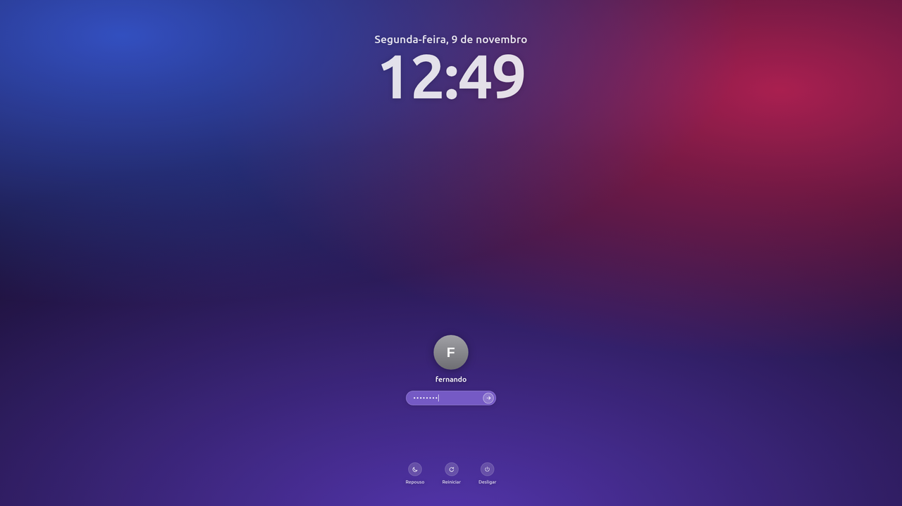

# Tela de login estilo macOS para Linux Mint

Tema para o **LightDM** (via [nody-greeter](https://github.com/JezerM/nody-greeter)) inspirado na tela de login do macOS:
relógio grande, foto e senha na parte de baixo, campo de vidro desfocado, "chacoalhar" na senha errada
e botões de Repouso / Reiniciar / Desligar.



## Recursos

- Data e hora em português, no estilo do macOS
- Foto do usuário (ou iniciais num círculo, se não houver foto)
- Aviso de Caps Lock, mensagem de senha incorreta e animação de erro
- **Fundo configurável**: qualquer imagem, ou acompanha o papel de parede da área de trabalho automaticamente
- Desfoque e escurecimento do fundo ajustáveis
- **Vários monitores**: o login aparece só no monitor principal; os demais mostram o fundo (ou são desligados durante o login)
- Tudo escala com a resolução (fica igual em 1080p e 4K)

## Instalação

```bash
git clone https://github.com/nandodmelo/macos-login-screen.git
cd macos-login-screen
sudo ./install.sh
macos-login testar     # abre a tela numa janela para conferir (não faz login)
```

O instalador:
1. instala o LightDM e o nody-greeter 1.6.2 (o `.deb` do GitHub é conferido por SHA-256);
2. copia o tema para `/usr/share/web-greeter/themes/macos`;
3. cria `/var/lib/macos-login` (pertence ao seu usuário, para trocar a imagem sem `sudo`);
4. configura o LightDM e troca o gerenciador de login (SLiM → LightDM).

A nova tela aparece no próximo boot.

### Se algo der errado

Na tela preta ou se o login não abrir: **Ctrl+Alt+F3**, entre com usuário e senha e rode

```bash
sudo ~/Documents/macos-login-screen/uninstall.sh   # volta para o SLiM
sudo reboot
```

`sudo ./uninstall.sh --purge` remove também o nody-greeter, o comando e as imagens.

## Configuração

Nenhum destes comandos precisa de `sudo`:

| Comando | O que faz |
|---|---|
| `macos-login status` | mostra a configuração atual |
| `macos-login imagem foto.jpg` | usa esta imagem de fundo (fixa) |
| `macos-login sincronizar on` | o fundo acompanha o papel de parede da área de trabalho |
| `macos-login desfoque 20` | desfoque do fundo em px (0 = nítido) |
| `macos-login escurecer 0.25` | escurece o fundo para dar contraste (0 a 0.8) |
| `macos-login nome "Fernando Melo"` | nome exibido abaixo da foto |
| `macos-login foto avatar.jpg` | foto do usuário |
| `macos-login relogio 12` | relógio de 12h (padrão 24h) |
| `macos-login tamanho 70` | tamanho do relógio, foto e textos em % (padrão 80) |
| `macos-login testar` | abre a tela de login numa janela |

### Monitores

Em `/etc/default/macos-login` (requer `sudo` para editar):

```bash
PRIMARY_OUTPUT=DP-0      # monitor do login (veja com: xrandr | grep " connected")
TURN_OFF_OTHERS=yes      # desliga as outras telas durante o login
```

## Pré-visualização no navegador

O tema funciona fora do LightDM com uma simulação (`mock.js`):

```
file:///caminho/theme/macos/index.html?bg=/caminho/imagem.jpg&typed=1
```

Na simulação a senha aceita é `teste`; `&wrong=1` mostra o erro de senha.

## Estrutura

```
theme/macos/        tema (HTML/CSS/JS) do nody-greeter
bin/macos-login     comando de configuração
system/             configs do LightDM/nody-greeter e script de monitores
install.sh          instalação
uninstall.sh        desinstalação
```
